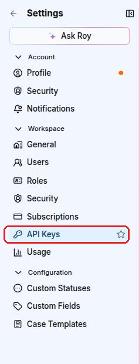

# Sekoia API documentation

<!-- include:docs/developer/quickstart.md -->
# Getting Started with the Sekoia API

The Sekoia REST API lets you access platform data, trigger actions, and build integrations or automations on top of Sekoia. The GUI itself is built on this API, so anything you can do in the interface, you can do via the API.

With the API you can, among other things:

- retrieve and manage **alerts**, **cases** and **detection rules**
- search **events** and query **telemetry**
- manage **assets**, **intakes** and **playbooks**

All endpoints exchange JSON over HTTPS and are authenticated with an API key sent as a Bearer token. The full list of endpoints is available in the [API Reference](api.md).

## Step 1: Find your base URL

The base URL depends on the region where your Sekoia subscription is hosted.

<table>
  <thead>
    <tr>
      <th>Region</th>
      <th style="white-space: nowrap">Base URL</th>
    </tr>
  </thead>
  <tbody>
    <tr><td>FRA1 (default)</td><td style="white-space: nowrap"><code>https://api.sekoia.io</code></td></tr>
    <tr><td>FRA2</td><td style="white-space: nowrap"><code>https://app.fra2.sekoia.io/api</code></td></tr>
    <tr><td>MCO1</td><td style="white-space: nowrap"><code>https://app.mco1.sekoia.io/api</code></td></tr>
    <tr><td>UAE1</td><td style="white-space: nowrap"><code>https://app.uae1.sekoia.io/api</code></td></tr>
    <tr><td>USA1</td><td style="white-space: nowrap"><code>https://app.usa1.sekoia.io/api</code></td></tr>
    <tr><td>SGP1</td><td style="white-space: nowrap"><code>https://app.sgp1.sekoia.io/api</code></td></tr>
  </tbody>
</table>

If you are unsure of your region, look at the URL you use to access the Sekoia.io application. For example, if you log in via `https://app.mco1.sekoia.io/`, your API base URL is `https://app.mco1.sekoia.io/api`.

## Step 2: Create an API key

All API requests are authenticated with an API key.


Only users with admin roles can create API keys.



Start with read-only permissions. You can always create a second key with write permissions when you need to perform write operations.


To create a key:

1. In Sekoia, go to **Settings > Workspace > API Keys**.

    

2. Click **+ API key**.
3. Give your key a name and a description.
4. Set an expiration date (30 days, 180 days, 365 days, or custom up to 1 year).
5. Select the permissions your key needs.
6. Click **Save** and copy the key immediately. It will only be shown once.

## Step 3: Make your first API call

To verify that your key works, retrieve your user profile. This endpoint requires no special permissions beyond a valid key.

```bash
export SEKOIA_API_KEY="your_api_key_here"

curl -X GET https://api.sekoia.io/v1/me \
  -H "Authorization: Bearer $SEKOIA_API_KEY"
```

A successful response looks like this:

```json
{
  "uuid": "2a4b6c8d-...",
  "email": "you@example.com",
  "firstname": "Jane",
  "lastname": "Doe"
}
```

If you can see your email and UUID, your setup is working.

## Troubleshooting

| Status code | Meaning | What to do |
| --- | --- | --- |
| `401 Unauthorized` | The API key is missing, expired, or invalid. | Check that the key is correctly copied and has not expired. |
| `403 Forbidden` | The key does not have the required permission for this endpoint. | Edit the key and add the missing permission, or create a new key with the right permissions. |
| `429 Too Many Requests` | You have exceeded the rate limit. | Wait before retrying. Add a delay between requests in your scripts. |

## Next steps

- [Search for rules](tutorials/search_rules.md): filter and retrieve detection rules from your catalog
- [Create a SIGMA rule](tutorials/create_sigma_rule.md): create a detection rule programmatically
- [Search events](tutorials/search_events.md): run an asynchronous event search and retrieve results
- [Filtering](filtering.md): filter and paginate API results with `match[<field>]`, date ranges and cursors
<!-- endinclude:docs/developer/quickstart.md -->

<!-- include:docs/developer/filtering.md -->
# Filtering

Many API methods accept filtering and matching parameters. A client can request specific content from the Sekoia API by specifying a set of filters.

## Match

The `match[<field>]` field parameter can be used to filter documents given the value of a specific `field`. A filter parameter can be specified any number of times, where all filter fields are handed together.

It should be noted that each `field` must not occur more than once. Multiple values of a match parameter are separated by a comma (U+002C COMMA, “,”) without any spaces. If multiple values are present, the match is treated as a logical OR.

**Examples of match parameters**

```
# list alerts triggered on entity entity1 or entity2
/alerts?match[entity_name]=entity1,entity2

# list alerts triggered on entity1 with rule named rule1 or rule2
/alerts?match[entity_name]=entity1&match[rule_name]=rule1,rule2
```

## Date ranges

The `date[field]` parameter can be used to filter documents given a date range on a specific `field`. The value of the parameter must be two dates separated by a comma (U+002C COMMA, ",") without any spaces. The first date is the start date and the second date is the end date.

Example of date range parameter: `date[created_at]=2025-09-22T01:20:00.000Z,2025-09-22T23:59:59.999Z`.

## Pagination

Many Sekoia API endpoints return large collections (alerts, assets, rules, events, intelligence objects, …). These endpoints are paginated. Depending on the product area, two main styles are used:

* **Offset / page-based pagination** (most XDR and Operations Center endpoints)
    * Use the `limit` query parameter to control how many items are returned in a single response.
    * Use either a `page` parameter (starting at `page=1`) or an `offset` parameter (starting at `offset=0`) as documented in each endpoint.
    * If you do not specify a `limit`, many endpoints default to **100 items per page**.
    * Each endpoint may define its own **maximum** allowed `limit` (commonly 100 or 1000); requesting more will either be rejected or silently capped by the API.

* **Cursor-based pagination** (Intelligence Center feeds)
    * Endpoints such as `GET /v2/inthreat/collections/{feed_id}/objects` use a **cursor**.
    * The request accepts a `limit` parameter. It returns STIX objects in an `items` field and a pagination cursor in `next_cursor`.
    * To fetch the next page, pass the cursor back using the `cursor` query parameter: `cursor={next_cursor}`.
    * By default, these endpoints return **100 objects** per request, and you can increase this up to **2000 objects** with `limit`.
    * You can safely stop when `items` is empty or when fewer than `limit` items are returned.

For both styles, the safest way to iterate over a complete collection is to **loop until the API returns fewer items than requested**, rather than assuming a fixed number of pages.

**Example – iterating 1,000 items across pages (offset/page-based)**

The example below illustrates how to retrieve up to 1,000 items using `limit=100` and a `page` parameter, stopping early if fewer results are returned:

```python
import requests

API_KEY = "YOUR_API_KEY"
BASE_URL = "https://api.sekoia.io/v1"

def list_items():
    headers = {"Authorization": f"Bearer {API_KEY}"}
    endpoint = f"{BASE_URL}/sic/conf/rules-catalog/rules"

    all_items = []
    limit = 100
    max_items = 1000

    page = 1
    while len(all_items) < max_items:
        params = {"limit": limit, "page": page}
        response = requests.get(endpoint, headers=headers, params=params)
        response.raise_for_status()

        data = response.json()
        items = data.get("items", data)

        all_items.extend(items)

        # Stop if the API returned less than requested (no more pages)
        if len(items) < limit:
            break

        page += 1

    return all_items[:max_items]

if __name__ == "__main__":
    results = list_items()
    print(f"Fetched {len(results)} items")
```

For cursor-based endpoints, the same pattern applies, but you replace the `page`/`offset` parameter with a `cursor` parameter and update it with the `next_cursor` value returned by the API on each iteration.
<!-- endinclude:docs/developer/filtering.md -->


<script>
    window.onload = ()=> {
        OpenAPIViewer.init({
            title:"Sekoia API Documentation",
            regions: [
                "FRA1",
                "FRA2",
                "MCO1",
                "UAE1",
                "USA1",
                "SGP1"
            ],
            urls: [
                "https://app.sekoia.io/api/v1/dashboard/swagger.json?context=public",
                "https://app.sekoia.io/api/v1/telemetry/openapi.json?context=public",
                "https://app.sekoia.io/api/v1/events/openapi.json?context=public",
                "https://app.sekoia.io/api/v1/notebooks/openapi.json?context=public",
                "https://app.sekoia.io/api/v1/sic/conf/swagger.json?context=public",
                "https://app.sekoia.io/api/v1/swagger.json?context=public",
                "https://app.sekoia.io/api/v1/ingest/swagger.json?context=public",
                "https://app.sekoia.io/api/v1/sic/swagger.json?context=public",
                "https://app.sekoia.io/api/v1/symphony/swagger.json?context=public",
                "https://app.sekoia.io/api/v2/asset-management/openapi.json?context=public",
                "https://app.sekoia.io/api/v1/edl-gateway/openapi.json",
                "https://app.sekoia.io/api/v2/inthreat/swagger.json?context=public",
            ],
            tag_mappings:{
                "mfa": "MFA",
                "me": "User profile",
                "automations": "Automation",
                "Observables relationships": "Observable relationships",
                "Object relationships": "Relationships",
                "api-keys": "API Keys",
                "content-proposals": "Content proposals",
                "content-proposals-comments": "Content proposals",
                "content-proposals-relationships": "Content proposals",
                "content-proposals-objects": "Content proposals",
                "content-proposals-observables": "Content proposals",
                "content-proposals-observables-relationships": "Content proposals",
                "content-proposals-objects-relationships": "Content proposals"
            },
            intro: [
                "Quickstart",
                "Filtering",
            ],
            menu:[
                {
                    name: "User",
                    tags: [
                        "User Authentication",
                        "User profile",
                        "MFA",
                        "permissions",
                    ],
                },
                {
                    name: "Workspace",
                    tags: [
                        "customers", // TODO deprecated, get rid of it
                        "communities",
                        "API Keys",
                        "licenses",
                        "invitations",
                        "plans",
                        "sub-communities",
                        "avatars",
                        "users", // TODO set this tag on all user administration endpoints
                        "roles",
                        "counters", // TODO => +Avatars
                    ],
                },
                {
                    name: "Configuration",
                    tags: [
                        "Entities",
                        "Enrichers",
                        "Callbacks",
                        "Services",
                        "Intakes",
                        "Assets",
                        "Atoms",
                        "Intakes by status",
                        "Intakes errors and warnings",
                        "Intakes lag and processing lag",
                        "formats",
                        "Intake Optimization Rules",
                    ]
                },
                {
                    name: "Intelligence",
                    tags: [
                        "Objects",
                        "CTI Objects", // TODO fix telemetry => Objects
                        "Indicators",
                        "Observables",
                        "Observable relationships",
                        "Exports",
                        "Kill Chains",
                        "Outgoing Feeds",
                        "Collections",
                        "MISP",
                        "TAXII",
                        "Bundles",
                        "Images",
                        "Labels",
                        "Graphs",
                        "Relationships",
                        "Reports",
                        "Support",
                        "Sources",
                        "Vulnerabilities",
                    ],
                },
                {
                    name: "Detection",
                    tags: [
                        "Rules",
                            "compilation-reports", // TODO sicconf => Rules
                            "rules-catalog-multi-tenant", // TODO sicconf => Rules
                            "rules-catalog", // TODO sicconf => Rules
                        "Alerts",
                        "datasources",
                        "generation-modes", // TODO sicconf => Generation modes
                        "Alert filters",
                        "IOC Collections",
                        "Alerts",
                            "Alert", // TODO sicalert => Detection+Alerts
                            "Alert Entities", // TODO sicalert => Detection+Alerts
                            "Alert Rules", // TODO sicalert => Detection+Alerts
                            "Alert Sources and Targets", // TODO sicalert => Detection+Alerts
                            "Stats", // TODO sicalert => Detection+Alerts+Alert stats
                            "Alert Status", // TODO sicalert => Detection+Alerts
                            "Alert Type", // TODO sicalert => Detection+Alerts
                        "Countermeasures",
                        "Cyber Kill Chain",
                        "UEBA",
                    ],
                },
                {
                    name: "Investigation",
                    tags: [
                        "Cases",
                            "Case", // TODO => Cases
                            "Comments", // TODO => + Cases
                        "Notebooks",
                        "Events",
                        "Tasks",
                    ],
                },
                {
                    name: "Automation",
                    tags: [
                        "Playbooks",
                        "Playbook actions telemetry",
                        "modules",
                        "Playbook runs",
                            "Playbooks runs", // TODO: Fix symphony => Playbook runs
                        "Node runs",
                        "Action Runs",
                        "Actions",
                        "Connector Configurations",
                        "Connectors",
                        "Module Configurations",
                        "Modules",
                        "Runs",
                        "Trigger Configurations",
                        "Triggers",
                        "SSH Keys",
                    ],
                },
                {
                    name:"Reporting",
                    tags: [
                        "dashboards",
                        "Intelligence",
                            "Intelligence statistics", // => Intelligence
                        "Events",
                        "Rules",
                        "Alert filters",
                        "Assets",
                        "Automation statistics",
                        "AI assistant",
                        "Statistics", // ?
                    ]
                },
                { name: "TIP",
                    tags:[
                        "Content proposals",
                        "Content proposals relationships",
                        "Expiration rules",
                        "Incoming synchronization",
                        "Warning rules"
                    ]
                }
            ]
        })
    };
</script>
