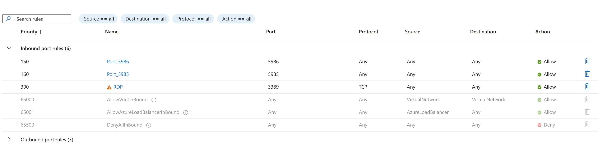
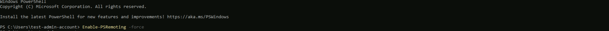
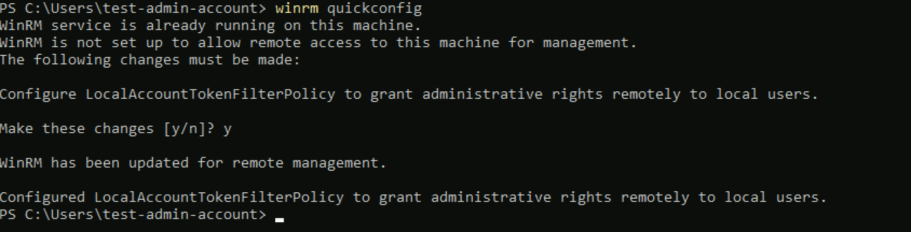
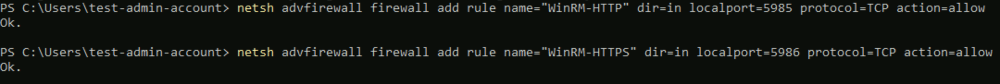
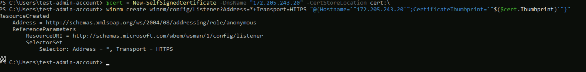
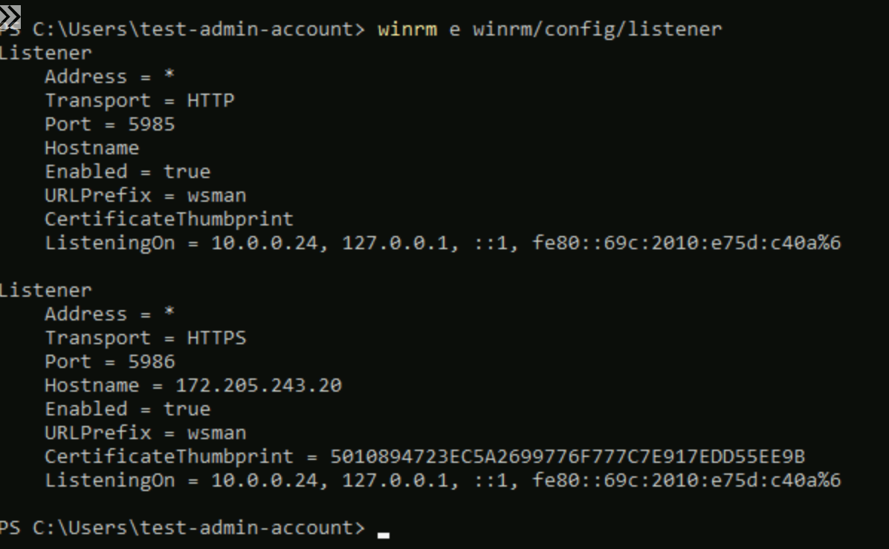
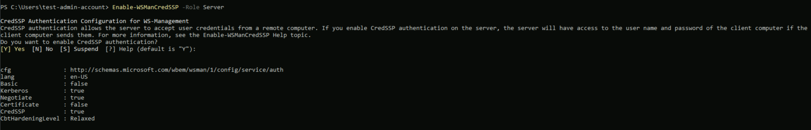

# Microsoft Windows Server


Microsoft Windows Server is an operating system designed for server-based computing, offering robust server management, data storage, and networking capabilities for businesses and enterprises, facilitating diverse workloads and IT operations.

## Configuration

| Name      |  Type   |  Description  |
| --------- | ------- | --------------------------- |
| `username` | `string` | Username to do authentication on remote server |
| `password` | `string` | Password to do authentication on remote server |

## Actions

### Change User Password

Changes specified user password on remote server

**Arguments**

| Name      |  Type   |  Description  |
| --------- | ------- | --------------------------- |
| `user_to_update` | `string` | Username you want to change password for |
| `new_password` | `string` | New password for user |
| `server` | `string` | Remote server dns name or IP address |

### Disable Users

Disable specified users on remote server

**Arguments**

| Name      |  Type   |  Description  |
| --------- | ------- | --------------------------- |
| `users` | `array` | List of user names to disable. `sids` or `users` must be specified |
| `sids` | `array` | List of SID`s to disable. `sids` or `users` must be specified |
| `server` | `string` | Remote server dns name or IP address |

### Enable Users

Enable specified users on remote server

**Arguments**

| Name      |  Type   |  Description  |
| --------- | ------- | --------------------------- |
| `users` | `array` | List of user names to enable. `sids` or `users` must be specified |
| `sids` | `array` | List of SID`s to enable. `sids` or `users` must be specified |
| `server` | `string` | Remote server dns name or IP address |

## Set up

## How to configure Microsoft Windows Server module

The module runs PowerShell commands on the remote server through WinRM, authenticating with CredSSP. WinRM and CredSSP must therefore be enabled on the server.

### Prerequisites

Make sure you can access the remote server with Administrator privileges, and that it accepts remote connections on port `5985` (WinRM over HTTP, the port the module connects to). Port `5986` (WinRM over HTTPS) is only needed if you also set up an HTTPS listener (see the optional step below).

You can find more information about the WinRM configuration in the [Microsoft documentation](https://docs.microsoft.com/en-us/windows/win32/winrm/installation-and-configuration-for-windows-remote-management).

If you are using an Azure VM, please check this [documentation](https://docs.microsoft.com/en-us/azure/virtual-machines/windows/winrm) and allow the WinRM ports in the `Network settings` tab of your machine. Below is an example of security rules for WinRM.



### Configure WinRM on the remote server

1. Open a PowerShell console as Administrator on the remote server
2. Execute the command `Enable-PSRemoting -force`

    

3. Execute the command `winrm quickconfig`

    

4. Create the firewall rules allowing traffic to the remote server on port `5985` for WinRM HTTP and `5986` for WinRM HTTPS

    ```powershell
    netsh advfirewall firewall add rule name="WinRM-HTTP" dir=in localport=5985 protocol=TCP action=allow
    netsh advfirewall firewall add rule name="WinRM-HTTPS" dir=in localport=5986 protocol=TCP action=allow
    ```

    

5. (Optional) Create a certificate for WinRM HTTPS and add an HTTPS listener with the certificate thumbprint

    ```powershell
    $cert = New-SelfSignedCertificate -DnsName "<DNS or IP>" -CertStoreLocation cert:\
    winrm create winrm/config/Listener?Address=*+Transport=HTTPS "@{Hostname=`"<DNS_Name or IP>`";CertificateThumbprint=`"$($cert.ThumbPrint)`"}"
    ```

    

6. Validate the listeners with `winrm e winrm/config/listener`

    

7. Enable CredSSP on the server with `Enable-WSManCredSSP -Role Server`

    


## Extra

Module **`Microsoft Windows Server` v1.1.1**