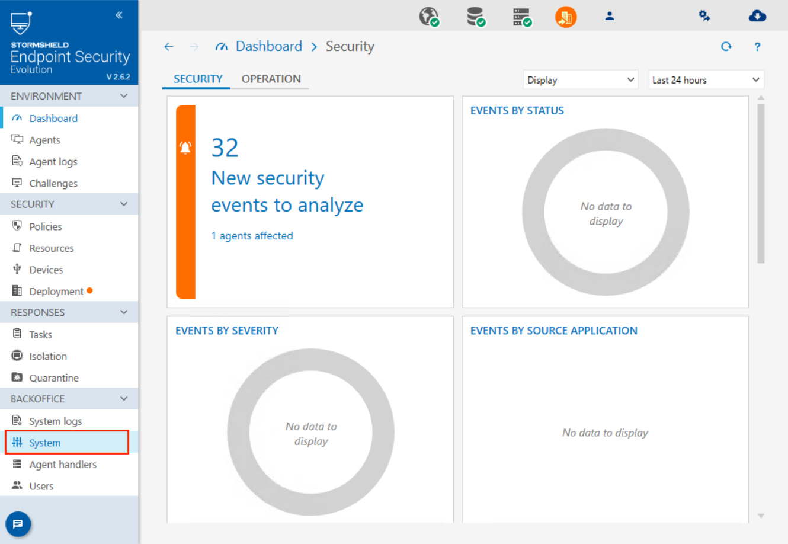
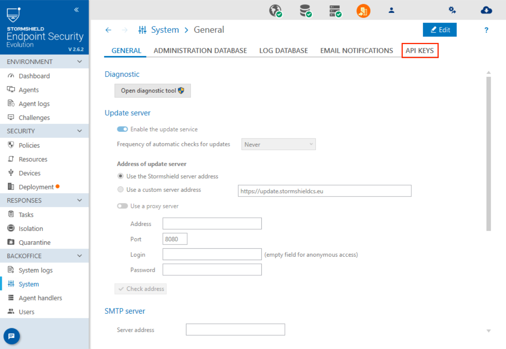
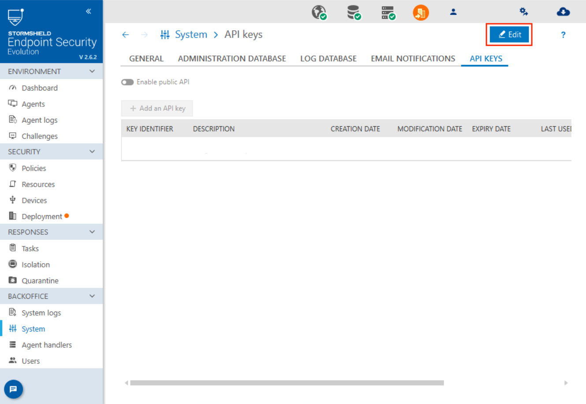
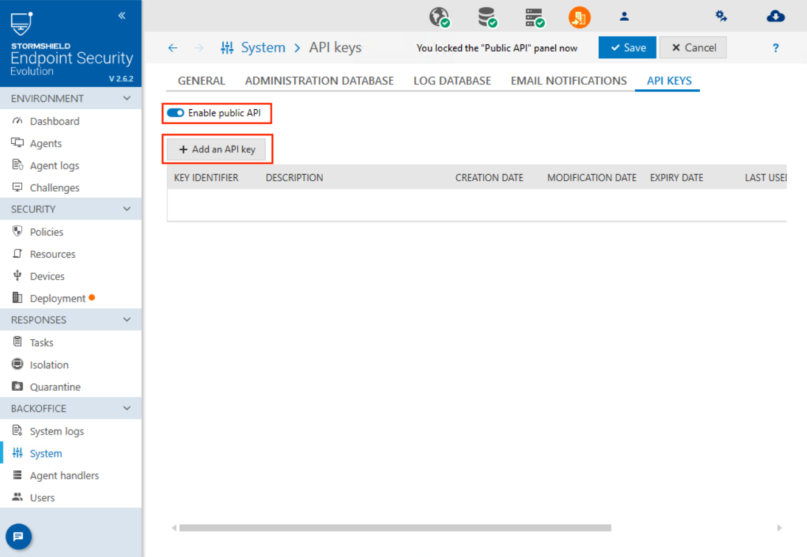
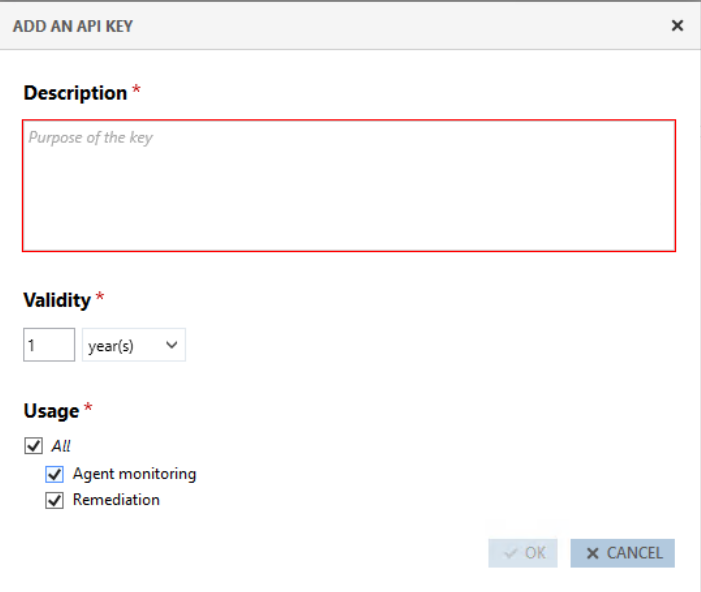
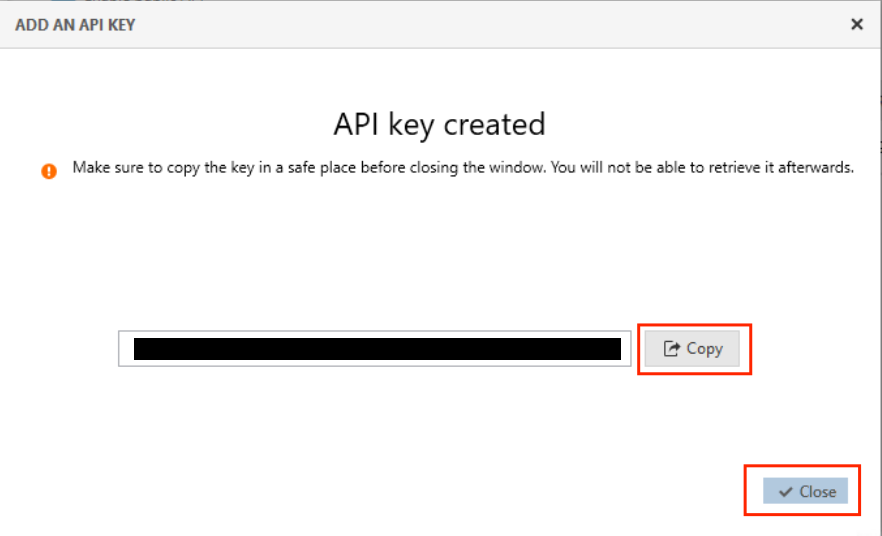
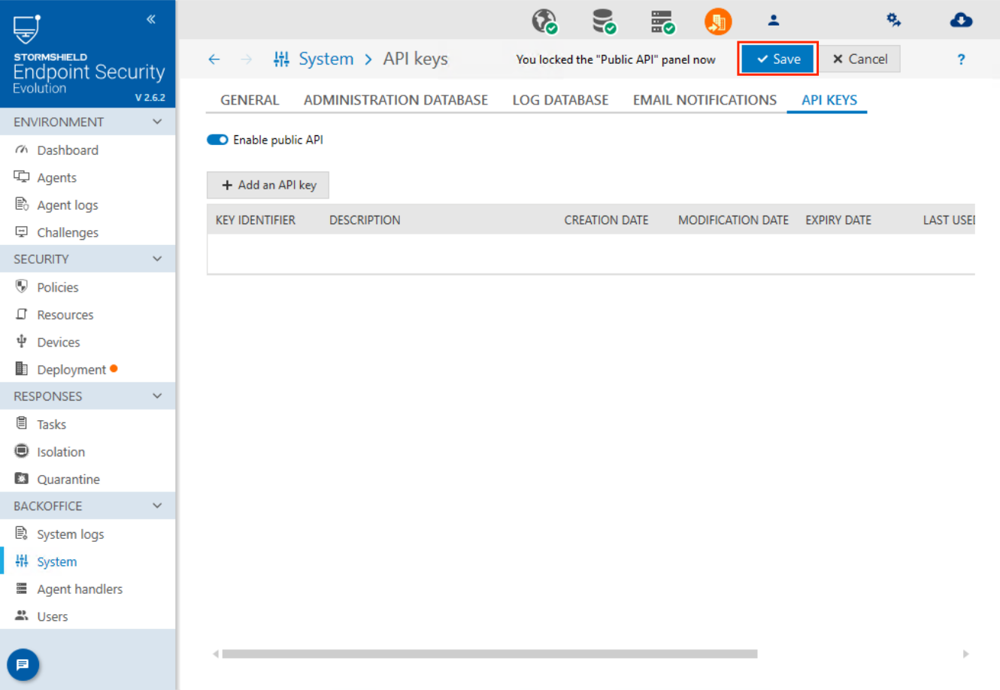

# Stormshield SES

Stormshield SES is designed to protect endpoints such as desktops, laptops, and servers against a variety of threats and cyberattacks.

## Configuration

| Name      |  Type   |  Description  |
| --------- | ------- | --------------------------- |
| `url` | `string` | URL of the Stormshield instance |
| `api_token` | `string` | Authentication token for the API |

## Actions

### Deisolate agent

Deisolate an agent

**Arguments**

| Name      |  Type   |  Description  |
| --------- | ------- | --------------------------- |
| `id` | `string` | Name or identifier of the agent |
| `comment` | `string` | Comment |
| `verify_certificate` | `boolean` | Is the server certificate verified |

**Outputs**

| Name      |  Type   |  Description  |
| --------- | ------- | --------------------------- |
| `taskId` | `string` | Task ID |
| `status` | `string` | Task status |
| `requestTime` | `string` | Task request time |
| `startTime` | `string` | Task start time |
| `endTime` | `string` | Task end time |
| `errorCode` | `integer` | Error code |
| `errorMessage` | `string` | Error message |

### Isolate agent

Isolate an agent

**Arguments**

| Name      |  Type   |  Description  |
| --------- | ------- | --------------------------- |
| `id` | `string` | Name or identifier of the agent |
| `forceServerIsolation` | `boolean` | Boolean to force the isolation |
| `comment` | `string` | Comment |
| `verify_certificate` | `boolean` | Is the server certificate verified |

**Outputs**

| Name      |  Type   |  Description  |
| --------- | ------- | --------------------------- |
| `taskId` | `string` | Task ID |
| `status` | `string` | Task status |
| `requestTime` | `string` | Task request time |
| `startTime` | `string` | Task start time |
| `endTime` | `string` | Task end time |
| `errorCode` | `integer` | Error code |
| `errorMessage` | `string` | Error message |

### Quarantine file

Quarantine a file

**Arguments**

| Name      |  Type   |  Description  |
| --------- | ------- | --------------------------- |
| `id` | `string` | Name or identifier of the agent |
| `filePath` | `string` | Path to the file to quarantine |
| `bypassExcludedDirectories` | `boolean` | Boolean to bypass excluded directories |
| `verify_certificate` | `boolean` | Is the server certificate verified |

**Outputs**

| Name      |  Type   |  Description  |
| --------- | ------- | --------------------------- |
| `taskId` | `string` | Task ID |
| `status` | `string` | Task status |
| `requestTime` | `string` | Task request time |
| `startTime` | `string` | Task start time |
| `endTime` | `string` | Task end time |
| `errorCode` | `integer` | Error code |
| `errorMessage` | `string` | Error message |

### Restore quarantine file

Restore stormshield quarantined file

**Arguments**

| Name      |  Type   |  Description  |
| --------- | ------- | --------------------------- |
| `id` | `string` | Name or identifier of the agent |
| `fileHashSha256` | `string` | File hash sha256 |
| `overwriteExistingFile` | `boolean` | Boolean to overwrite any existing file |
| `verify_certificate` | `boolean` | Is the server certificate verified |

**Outputs**

| Name      |  Type   |  Description  |
| --------- | ------- | --------------------------- |
| `taskId` | `string` | Task ID |
| `status` | `string` | Task status |
| `requestTime` | `string` | Task request time |
| `startTime` | `string` | Task start time |
| `endTime` | `string` | Task end time |
| `errorCode` | `integer` | Error code |
| `errorMessage` | `string` | Error message |

### Terminate process

Terminate a process

**Arguments**

| Name      |  Type   |  Description  |
| --------- | ------- | --------------------------- |
| `id` | `string` | Name or identifier of the agent |
| `processPath` | `string` | Executable path of the process to kill on the computer |
| `terminateProcessTree` | `boolean` | Boolean to terminate the process tree |
| `verify_certificate` | `boolean` | Is the server certificate verified |

**Outputs**

| Name      |  Type   |  Description  |
| --------- | ------- | --------------------------- |
| `taskId` | `string` | Task ID |
| `status` | `string` | Task status |
| `requestTime` | `string` | Task request time |
| `startTime` | `string` | Task start time |
| `endTime` | `string` | Task end time |
| `errorCode` | `integer` | Error code |
| `errorMessage` | `string` | Error message |

### Wait for a Stormshield task to complete

Wait until the status of the task is Succeeded or Failed

**Arguments**

| Name      |  Type   |  Description  |
| --------- | ------- | --------------------------- |
| `task_id` | `string` | Task ID |
| `verify_certificate` | `boolean` | Is the server certificate verified |

**Outputs**

| Name      |  Type   |  Description  |
| --------- | ------- | --------------------------- |
| `taskId` | `string` | Task ID |
| `status` | `string` | Task status |
| `requestTime` | `string` | Task request time |
| `startTime` | `string` | Task start time |
| `endTime` | `string` | Task end time |
| `errorCode` | `integer` | Error code |
| `errorMessage` | `string` | Error message |

## Set up

## Configuration

1. Log in to the StormShield Console as administrator
2. On the left panel, go to `System`

     

3. Click the `API KEYS` tab

     

4. Click the `EDIT` button

     

5. Turn on the `Enable public API` toggle and Click `Add an API Key`

     

6. Enter a description for the API Key and an expiration time
7. Turn on the `Agent Monitoring` and `Remediation` options
8. Click `Ok`

     

9. Copy the API Key identifier and click `Close`

     

10. Click `Save`

     

## Extra

Module **`Stormshield SES` v1.0.1**