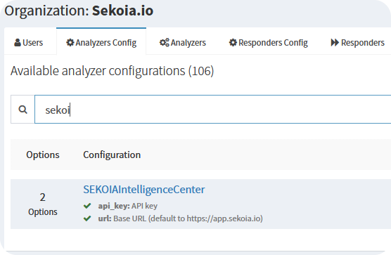
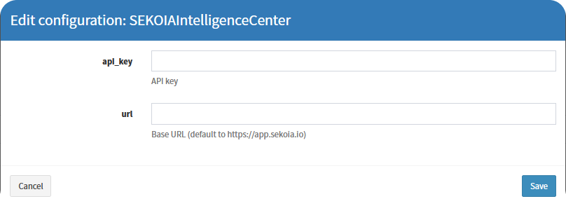
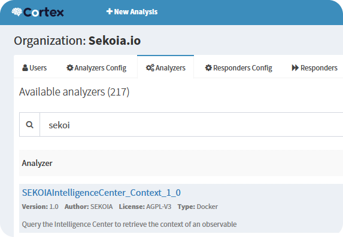
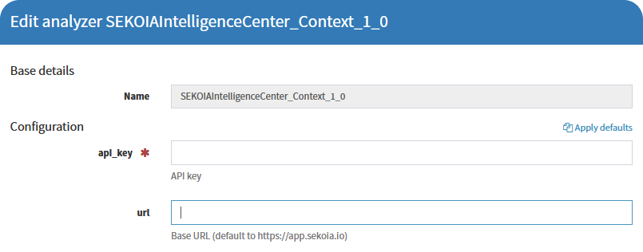
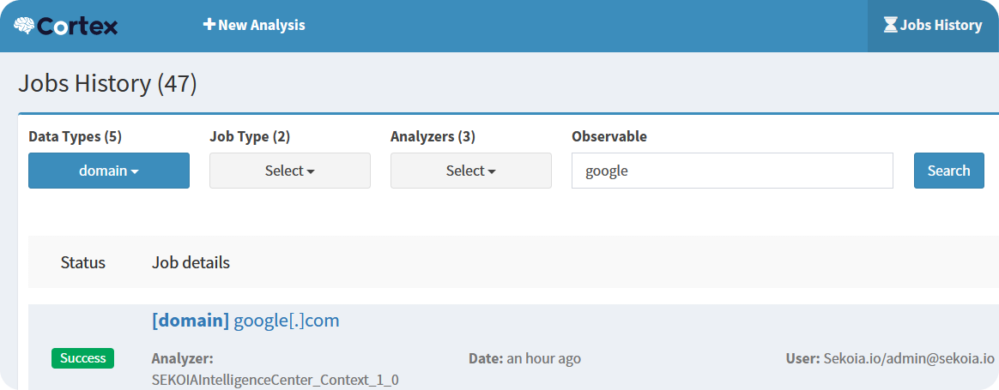
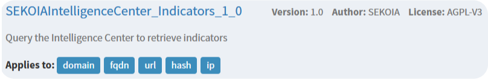
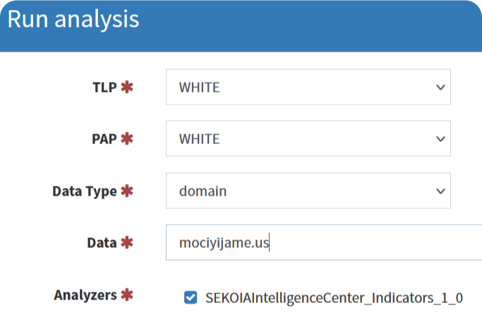
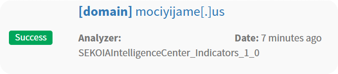
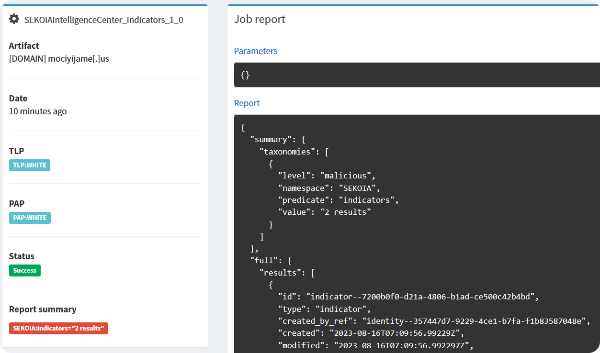
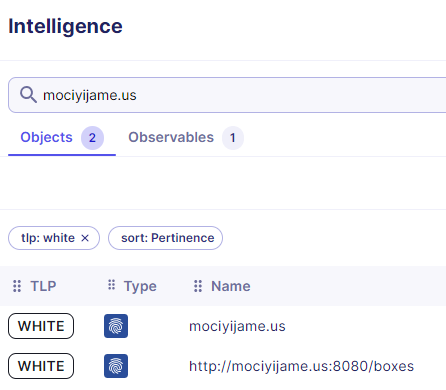

# Cortex Analyzer

Sekoia.io is providing a [Cortex analyzer](https://github.com/TheHive-Project/Cortex-Analyzers/tree/master/analyzers/SEKOIAIntelligenceCenter) to enrich data in [TheHive](https://thehive-project.org/) ecosystem.

## Objective

Collect Sekoia.io CTI feed in an existing Cortex instance self-managed, for any operational purpose such as CTI aggregation, dissemination, hunting...

## Prerequisites:

* An operational Cortex instance with administrator privileges
* An active Sekoia.io licence with access to the CTI
* An API key with the permission "View intelligence"

## 1. Connect to Cortex


Cortex instance must be activated on your server


1. In a Web browser, type the following _http://server\_ip:cortex\_port_
2. Enter your login and password of your Cortex instance setup beforehand with `orgadmin` role

## 2. Configuration

### 1. Setup the Analyzer configuration


The setup of Analyzers in Cortex will allow to be used in Cortex and in theHive

1. Select your _Organization_ on the top right corner


2. Go to _Analyzers Config_ tab and Search `SekoiaIntelligenceCenter` 
3. Edit and Add your Sekoia API key and Base url 


If your Sekoia community is hosted on FRA1 region, leave the "Base url" field empty.


### 2. Enable and Setup the Analyzer

The configuration setup in the previous section will provide 3 Analyzers to enable and setup:

* SEKOIAIntelligenceCenter\_Indicators\_1\_0
* SEKOIAIntelligenceCenter\_Context\_1\_0
* SEKOIAIntelligenceCenter\_Observables\_1\_0

Here is below one example of setup to be done for the 3 analyzers:

1. Go to _Analyzers_ tab and Search `SekoiaIntelligenceCenter` 
2. Edit and Add your `Sekoia API key` and `Base url` 

## 3. Sekoia intelligence in Cortex

In the following section, you will find information on how Sekoia intelligence is available in Cortex

### Summary of the information

| Artefact   | Analyzers                                   | in Cortex               | in Sekoia.io                                                                                                                                                                                                                           |
| ---------- | ------------------------------------------- | ----------------------- | -------------------------------------------------------------------------------------------------------------------------------------------------------------------------------------------------------------------------------------- |
| Indicator  | SEKOIAIntelligenceCenter\_Indicators\_1\_0  | indicators              | Details of an [indicator](../consume/observables.md) also called IOC (Indicator of Compromission) such as Dates, Confidence level, Indicator types, Kill chain, Pattern. The indicator is found under objects tab of Intelligence page |
| Context    | SEKOIAIntelligenceCenter\_Context\_1\_0     | context of an indicator | Side details in an indicator (Related threats, Linked Observables, Latest reports, Indicator types, Kill chain)                                                                                                                        |
| Observable | SEKOIAIntelligenceCenter\_Observables\_1\_0 | known observables       | [Observable](../consume/observables.md) under observables tab of Intelligence page                                                                                                                                                     |

## 4. Steps to retrieve and search Sekoia intelligence

### Search existing Sekoia intelligence in Cortex

1. Select `Data Types`, `Job Type` and `Analyzers`
2. Type your indicator or observable in the Observable search bar (here is an example with `Google`)

### Verify a Sekoia feed artefact in Cortex

Here is an example on how to verify if a Sekoia Indicator exist in Cortex and import its content for verification (same process for Context and Observable)


* IOC (associated threat) is found on Indicator
* Details of an Indicator (IOC) is found on Indicator
* Observables is found on Observable


1. Go to Sekoia.io connector `Analyzers > SEKOIAIntelligenceCenter_Indicators` and click on button Run (button play symbol in the right side)

2. Fill the information with the indicator 
3. Check the indicator in _Jobs History_ 
4. Check the Sekoia indicator 
5. Check the Indicator in Sekoia Intelligence page 

## 5. Troubleshoot

1. Make a verification on the artefact, follow steps of `Verify a Sekoia feed artefact in Cortex` (see previous section)
2. Check the jobs in _Jobs History_ tab to see if the observable or the indicator have been retrieved AND
3. Compare this artefact in Sekoia Intelligence Center under the Intelligence page

## 6. Other resources

* **The Cortex official documentation**

https://github.com/TheHive-Project/CortexDocs/blob/master/installation/install-guide.md#docker

http://docs.thehive-project.org/cortex/user-guides/first-start/

https://github.com/TheHive-Project/CortexDocs/blob/master/admin/quick-start.md
