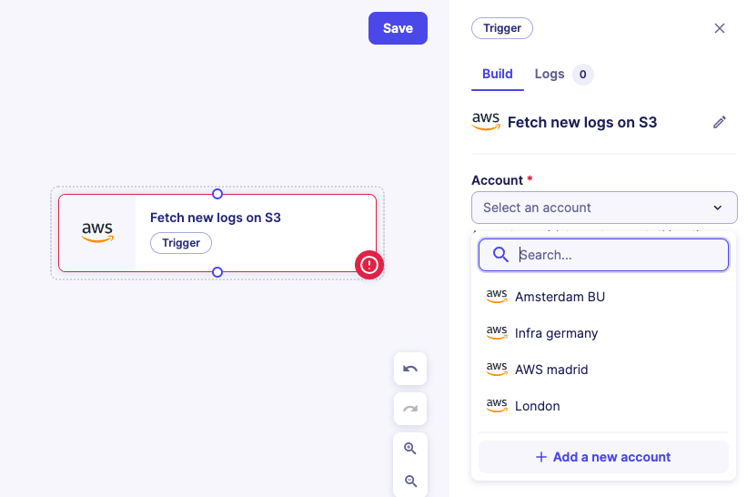

# Manage accounts

You can centralize the management of your accounts to your third-party tools in the "Accounts" menu.

This allows you to re-use these accounts between your multiple playbook actions without having to copy and paste this information.

## Create a new account

* Click `Accounts > New accounts` and select a service.
* Enter your credentials and save

## How to use your accounts

Once your account has been created, you can use it (and reuse it) in every node configuration.


If you are in multi-tenant mode, only accounts linked to the same tenant will appear in this list.


