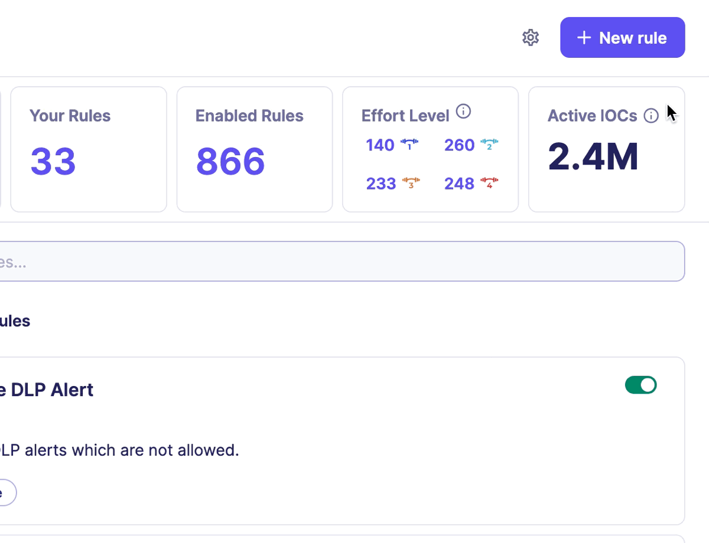
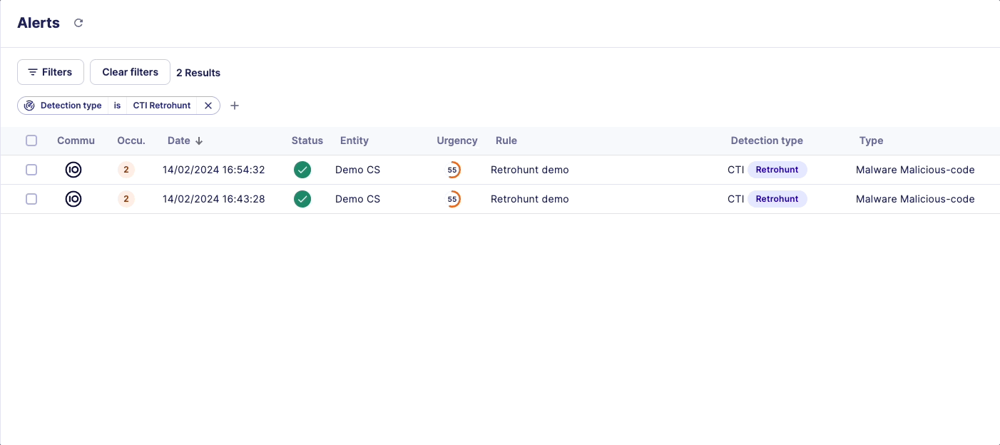
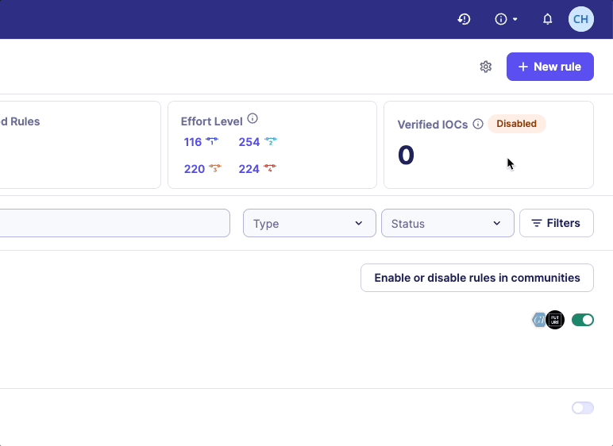

# IOCs Detection

IOC detection is a critical mechanism in detecting attacks that are trying to harm your system or have already breached it. The Sekoia SOC platform is powered by our Threat Detection & Research (TDR) team, which constantly enriches our IOC database with its state-of-the-art investigations and extensive expertise in Intelligence.

With IOC detection, you can automatically identify potential threats in your past and future events by monitoring active IOCs.

## How does IOC detection at Sekoia work?

Sekoia Threat Detection & Research (TDR) team maintains the CTI database with millions of IOCs through their investigation and dedicated expertise. All this incredible work benefits Sekoia XDR clients, who can consult the number of IOCs available on the Rules catalog page in the section `Active IOCs`.

Each new event ingested by Sekoia XDR is scanned against our CTI database. If an Indicator is detected, our Sekoia Intelligence Feed rule will immediately alert you.

### Sekoia Retrohunt engine

Each time a new indicator is added to our CTI database, Sekoia XDR will also perform retrohunting on all available events that were ingested in the past. It means that Sekoia XDR doesn't miss any past or ongoing attacks within your system.

#### How do you recognize a retrohunt alert?

On the Alerts page, look for the Detection type of the alert. `CTI Retrohunt` alerts are triggered retroactively when a new indicator appears in our CTI database.

#### Would your SOC team like to scan a specific list of IOCs to perform retrohunt?

That’s possible via the IOC collections. You can import a specific list of IOCs to perform retrohunting. Please see the dedicated documentation on [IOC Collections](ioccollections.md).

## Technical dive into IOC detection

We will detail some technical concepts around IOC detection and explain how to enable and correctly use IOC detection.

### Enable IOC detection

Our recommendation is to enable the Sekoia Intelligence Feed rule. You will automatically benefit from the protection of our CTI database and its IOCs. Another option is to create your own custom CTI rule and choose a feed source. The feed source can be an IOC Collections provided by your SOC team.

If no CTI rule is enabled, a warning message will be displayed on the Rules catalog page.

### How far in the past is retrohunting performed?

Our IOC detection will perform a retrohunt based on the valid period of the indicator (valid from and valid until). By default, 5 additional days are always added to handle cases where the indicator has a specified valid period.

### Is retrohunt performed immediately after I import an indicator?

Sekoia XDR will perform retrohunting as soon as possible, depending on resource availability. We select the appropriate moment to perform this operation without altering user experience.

### Which event fields are verified when performing IOC detection?

The tables below list the ECS event fields that are verified by IOC detection.

#### Observable type: Domain Name

| STIX path         | ECS event field                                                                                                                                                                                                                                                                                                                                                                                                 |
| ----------------- | --------------------------------------------------------------------------------------------------------------------------------------------------------------------------------------------------------------------------------------------------------------------------------------------------------------------------------------------------------------------------------------------------------------- |
| domain-name:value | 
client.domain client.registered_domain destination.domain destination.registered_domain dns.question.name dns.question.registered_domain server.domain server.registered_domain source.domain source.registered_domain tls.[<em>client/server</em>].x509.alternative_names tls.[<em>client/server</em>].x509.subject.common_name url.domain url.registered_domain
 |

#### Observable type: Email Address

| STIX path                | ECS event field                                                                                                                                                                                                                                                                                                                                                                                                                         |
| ------------------------ | --------------------------------------------------------------------------------------------------------------------------------------------------------------------------------------------------------------------------------------------------------------------------------------------------------------------------------------------------------------------------------------------------------------------------------------- |
| email-addr:value         | 
client.user.email destination.user.email destination.user.full_name email.from.address email.sender.address email.to.address email.cc.address email.bcc.address file.x509.alternative_names&#x3C;brhost.user.email> server.user.email source.user.email source.user.full_name user.email user.effective.email user.target.email tls.[<em>client/server</em>].x509.alternative_names
 |
| email-addr:display\_name | 
destination.user.full_name source.user.full_name
                                                                                                                                                                                                                                                                                                                                                                              |

#### Observable type: File

| STIX path          | ECS event field                                                                                         |
| ------------------ | ------------------------------------------------------------------------------------------------------- |
| file:ctime         | file.created                                                                                            |
| file:hashes.MD5    | 
dll.hash.md5 email.attachments.file.hash.md5 file.hash.md5 process.hash.md5
             |
| file:hashes.SSDEEP | file.hash.ssdeep                                                                                        |
| file.hash.SHA-1    | 
file.hash.sha1 dll.hash.sha1 email.attachments.file.hash.sha1 process.hash.sha1
         |
| file.hash.SHA-256  | 
file.hash.sha256 dll.hash.sha256 email.attachments.file.hash.sha256 process.hash.sha256
 |
| file.hash.SHA-512  | 
file.hash.sha512 dll.hash.sha512 email.attachments.file.hash.sha512 process.hash.sha512
 |
| file:mime\_type    | file.mime\_type                                                                                         |
| file:mtime         | file.ctime                                                                                              |
| file:name          | file.name                                                                                               |
| file:size          | file.size                                                                                               |

#### Observable type: IPv4 Address & IPv6 Address


To avoid false positives, IP addresses that are marked as "Command an Control" are only matched against `destination.ip`.


| STIX path                                 | ECS event field                                                         |
| ----------------------------------------- | ----------------------------------------------------------------------- |
| 
ipv4-addr:value ipv6-addr:value
 | 
client.ip destination.ip host.ip server.ip source.ip
 |

#### Observable type: Network Traffic

| STIX path                                                              | ECS event field      |
| ---------------------------------------------------------------------- | -------------------- |
| network-traffic:dst\_port                                              | destination.port     |
| network-traffic:dst\_ref.value                                         | destination.ip       |
| network-traffic:extensions.http-request-ext.request\_header.User-Agent | user\_agent.original |
| network-traffic:src\_port                                              | source.port          |
| network-traffic:src\_ref.value                                         | source.ip            |

#### Observable type: URL

| STIX path | ECS event field                 |
| --------- | ------------------------------- |
| url:value | 
url.full url.original
 |

#### Observable type: Windows Registry Key

| STIX path                   | ECS event field |
| --------------------------- | --------------- |
| windows-registry-key:key    | registry.key    |
| windows-registry-key:values | registry.value  |

#### Observable type: X.509 Certificate

| STIX path                                        | ECS event field                                                    |
| ------------------------------------------------ | ------------------------------------------------------------------ |
| x509-certificate:issuer                          | 
x509.issuer.common_name x509.issuer.distinguished_name
   |
| x509-certificate:serial\_number                  | x509.serial\_number                                                |
| x509-certificate:signature\_algorithm            | x509.signature\_algorithm                                          |
| x509-certificate:subject                         | 
x509.subject.common_name x509.subject.distinguished_name
 |
| x509-certificate:subject\_public\_key\_algorithm | x509.public\_key\_algorithm                                        |
| x509-certificate:subject\_public\_key\_exponent  | x509.public\_key\_exponent                                         |
| x509-certificate:validity\_not\_before           | x509.not\_before                                                   |
| x509-certificate:validity\_not\_after            | x509.not\_after                                                    |
