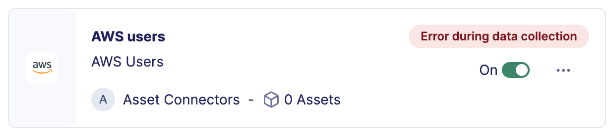
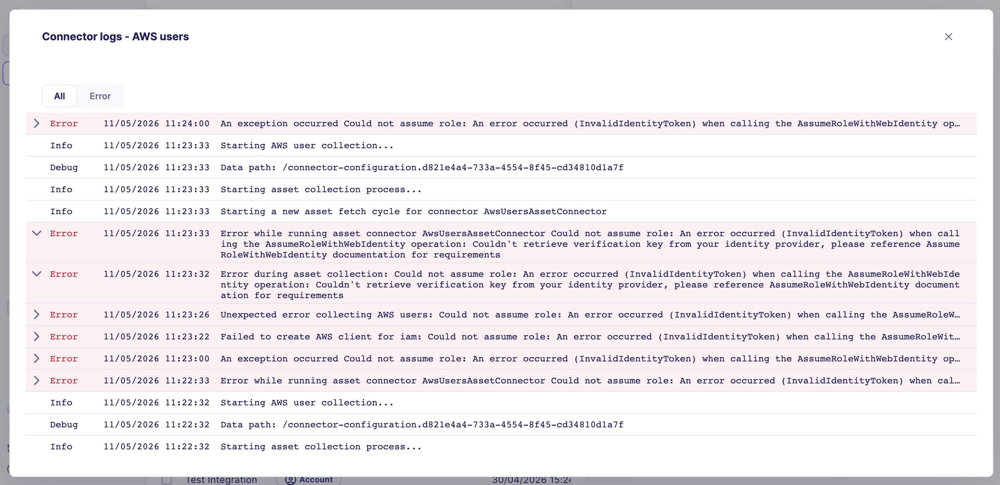

# Troubleshoot asset connectors

This article explains how to identify and resolve issues with asset connectors using error indicators and connector logs.

## Before you begin

To access the asset connector list, go to **Configure > Assets > Asset connectors**.

## Step 1: Identify a defective connector

Review the connector list. A connector with an issue displays an error message in the upper right corner of its tile.


**Zero assets warning**

If a connector tile shows 0 assets, this may indicate a synchronization issue even if no error message is visible. Inspect the logs to confirm.


## Step 2: Open the connector logs

1. On the defective connector tile, select **...**.
2. Select **View logs**.

The full log list opens.

## Step 3: Diagnose the issue

Review the log entries to identify the root cause. Common issues include:

| Symptom              | Likely cause                                                                                  |
| -------------------- | --------------------------------------------------------------------------------------------- |
| Authentication error | Invalid or expired credentials                                                                |
| Permission denied    | Insufficient rights on the external system                                                    |
| No assets retrieved  | The account cannot see any asset on the external system (wrong tenant or missing permissions) |
| Timeout              | Network connectivity issue or external system unavailable                                     |


**Connector running on a local runner**

If the connector runs on a local runner, confirm that the runner and connector belong to the same community.

1. Go to **Configure > Assets > Local runners**.
2. Confirm that the selected runner is **Up & running**.
3. Check the runner's last activity, hostname, and version.
4. If the runner is offline or cannot reach Sekoia, check the host connectivity, proxy configuration, Docker service, and Endpoint Agent logs.

For runner configuration and connectivity checks, see [Local runners](../defend/automate/playbooks-on-premises.md). For Endpoint Agent logs, see [Troubleshoot the Sekoia Endpoint Agent](https://docs.sekoia.com/integrations/action_library/overview).


## Step 4: Edit the connector configuration

If the issue is caused by a misconfiguration or expired credentials:

1. Close the logs panel.
2. On the connector tile, select **...**.
3. Select **Edit**.
4. Update the relevant fields such as the API key or client ID.
5. Select **Test connector** to validate the updated credentials.
6. When the test is conclusive, select **Edit asset connector**.

The connector resumes synchronization with the updated configuration.


**What the test checks**

The test validates credentials only. It does not retrieve assets. Verify asset retrieval from the **Assets** page after saving.


## Related articles

* [Create an asset connector](reveal_asset_connectors_create.md): How to configure a new asset connector from the integration catalog.
* [Reveal feature enablement matrix](reveal_feature_enablement.md): Which data sources are required for each Reveal capability.
* [Security controls](reveal_security_controls.md): How to verify connector coverage and identify visibility gaps from the asset context panel.
* [Troubleshoot Reveal](https://docs.sekoia.com/faq-and-troubleshooting/reveal_troubleshoot): General Reveal troubleshooting for missing data across capabilities.
* [Local runners](../defend/automate/playbooks-on-premises.md): How to check runner status and troubleshoot local execution.
* [Troubleshoot the Sekoia Endpoint Agent](https://docs.sekoia.com/integrations/action_library/overview): How to collect Endpoint Agent logs and diagnose connectivity issues.
