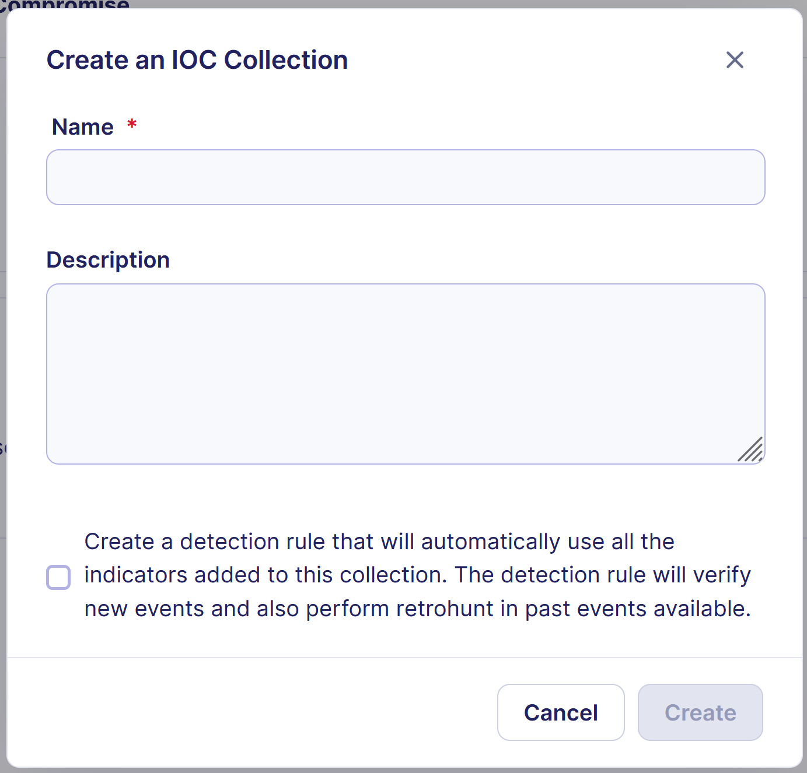
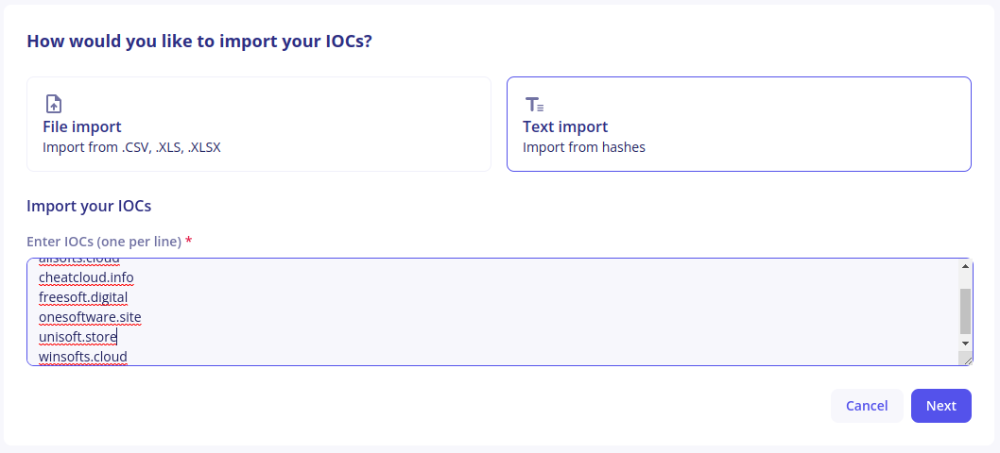
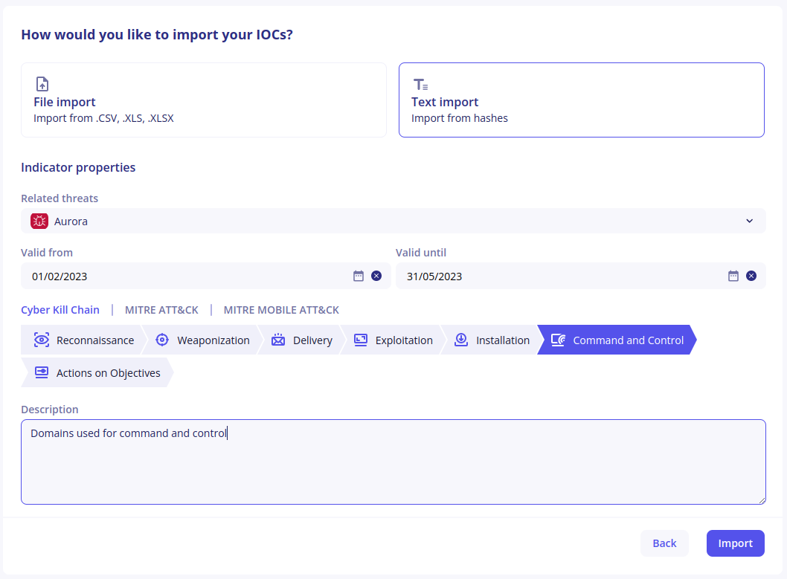
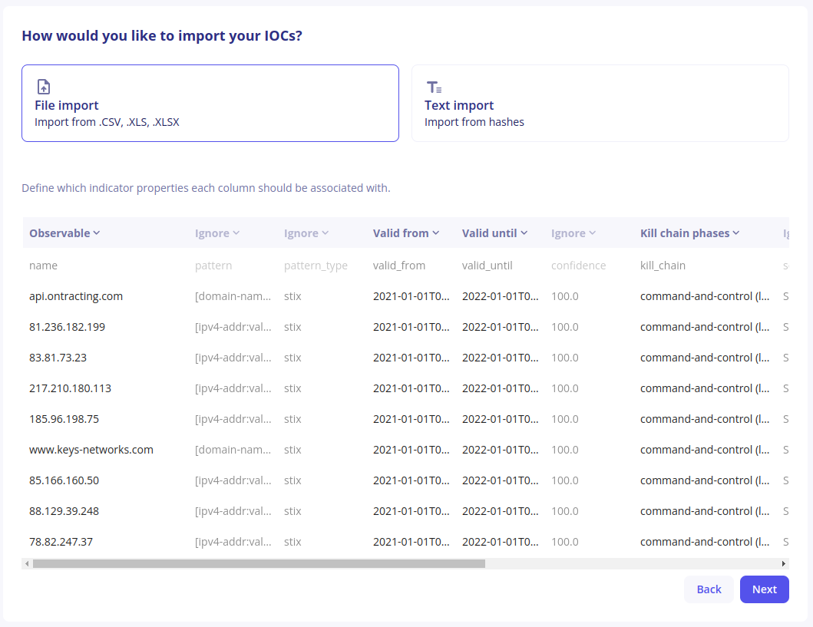
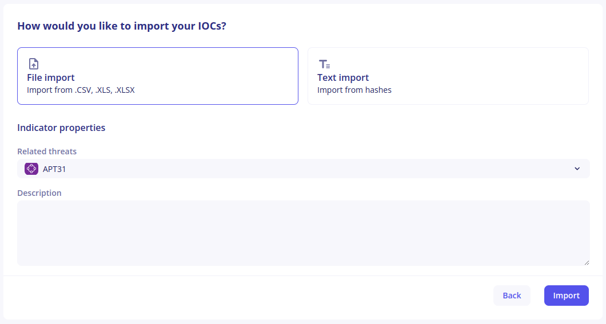

<!-- include:_shared_content/ioccollections.md -->
# IOC Collections

Indicators Of Compromise (IOCs) are commonly shared between CERT and SOC teams and by Cyber Threat Intelligence providers. They are an important part of detection.

While IOCs produced by Sekoia’s own Threat & Detection Research team are directly available inside the application, IOC Collections allow you to import indicators from other sources.

You can then easily see telemetry on these collections and use them inside detection rules.

## Create an IOC Collection

You can open the IOC Collection creation modal by clicking on `+ Collection`. You will then have to fill out the form:

- Define the name of the collection
- (Optional) Add a description to the collection
- Choose if you want to automatically add IOCs from this collection into your detection by creating a dedicated detection rule. Note that you will be able to manually create a detection rule for this collection later if you want


Inside a MSSP community, you also have to choose the community in which the IOC Collection should be created. If you choose “All communities”, the collection will be readable by all subcommunities.


## Import IOCs inside a collection

You can add indicators to a collection by clicking on the `Import` button. You will then have to choose between File Import and Text Import.

Each indicator inside the collection can have the following properties:

| Field                 | Description                                                                                                          |
|-----------------------|----------------------------------------------------------------------------------------------------------------------|
| Observable            | This is the actual IOC value (can be an IP address (IPv4 or IPv6), a MAC address,  a domain name, a URL, a file hash (MD5, SHA-1, SHA-256, SHA-512) or an email address) |
| Related Threats       | A list of threats that are related to this indicator. These threats have to exist inside the Intelligence Center        |
| Valid From            | The date from which this indicator should be considered valid                                                       |
| Valid Until           | The date from which this indicator should no longer be considered valid                                              |
| Kill Chain Phases     | Steps of the attack this indicator belongs to                                                                        |
| Description           | Any text that would add additional context. It is limited to **500 characters**                                      |


If you select the kill chain phase '**Command and Control**' when importing IP addresses in an IOC collection, our detection engines will only look into `destination.ip`. This is meant to reduce false positives, such as network scans.


### Limitations 

We allow a maximum **limit of 500,000 IOCs** entries that can be imported. This limit applies to the total IOC imports across all collections in a community. 

### Text Import

Text Import can be used when you want to import a list of IOCs (typically one IOC per line) that all have the same properties.

Add all your IOCs in the text field, then click on `Next`. 


You can only use IOC types listed into the [Observable description](#observable-field). 


On the next screen, select the additional properties to add intelligence context to your indicators. All fields are optional here:

Finally, click on `Import` to add indicators to your collection. Depending on the number of indicators your are importing at once, this can take some time.

### File Import

IOCs are commonly shared in tabular files where each indicator has its own row and additional context appears in different columns. File Import can be used with CSV, XLS and XLSX files to directly import indicators from these files.


You can only use IOC types listed into the [Observable description](#observable-field).


1. Upload the file you would like to process
2. The application will display the first 10 lines of the file, which a suggestion on how each column should be mapped to an indicator’s properties
    

3. Make sure the suggestions are correct and adjust if necessary by clicking on the chevron next to the column mapping. Use special value “Ignore” if the column should not be mapped to a property. In that case, the content of the column will be discarded.
4. Click on `Next`. If some indicator properties are not mapped by any column, you will have the opportunity to define values that will apply to all indicators.
    

5. Finally, click on `Import` and wait for indicators to be created. Depending on the numbers of indicators in your file, this can take some time.

## Indicator Actions

When inside a collection, buttons are available at the end of each line to update or revoke an indicator. If you are looking for a specific indicator within the collection, you can use the search bar above the table.

### Edit an indicator

1. Click on the `Edit` button
2. Modify the properties you would like to change inside the modal
3. Click on `Save`


The observable value cannot be changed.


### Revoke an indicator

If you realize that an indicator is bad and produces false positive detections, you can use the revoke button to remove it from detection.

#### How to Request the Revocation of an IoC

- Go to the **Intelligence** section in the left menu.
- Search for and select the object you believe is a false positive.
- Before reporting a false positive, make sure to carefully review the details associated with the object, including:
    - The **pattern**
    - The **source**
    - The **threat context**
    - Linked **observables**
- Click the **Request revocation** button available at the top right.


Revoking an indicator cannot be undone.

<!-- endinclude:_shared_content/ioccollections.md -->

## Telemetry Reports

Telemetry Reports can be used to quickly determine if any indicator inside the collection was seen within your events.

Telemetry Reports have the following properties:

- Telemetry is only available for some observable types: IP addresses, domain names and file hashes. File Hashes are only supported from January 31st, 2023
- Telemetry is checked for the past year, even if associated events are no longer available
- When looking at the telemetry for an indicator, the `valid from` and `valid until` dates are ignored

### Generate a telemetry report

Click on `Generate telemetry report` to automatically check all indicators against Sekoia.io’s telemetry. Depending on the numbers of indicators inside your collection, this can take a few minutes. When the report is available, the button will change to `See telemetry report`.


You don’t have to stay on this page waiting for your report to be available. When it eventually is, you will receive an in-app notification with a link.



Inside an MSSP community, the report will be generated for the communities that are currently selected.


### Display a telemetry report

You can access a telemetry report by clicking on the `See telemetry report` button or on the in-app notification indicating that the report is available.

Telemetry reports list all indicators inside the collection that were seen in events, ordered by the number of sightings. At the end of each line, there is a `Sightings` column indicating the number of sightings for this indicator. Clicking on this number will show you the detailed telemetry heatmap.

## Detect threats using IOC Collections

Any IOC Collection can be used inside a detection rule in the Operations Center. Creating a rule for an IOC Collection has the following benefits:

- Any match of an indicator in future events will create an Alert
- Any match of an indicator in past events will create an Alert (retrohunt)


Detection rules using IOC Collections are taking the validity period of an indicator when creating alerts.


To create a detection rule based on an IOC Collection, you can:

- Select the option inside the IOC Collection creation modal
- Create a rule from the Rules Catalog. Choose `CTI` as rule type and `IOC Collections` as source
