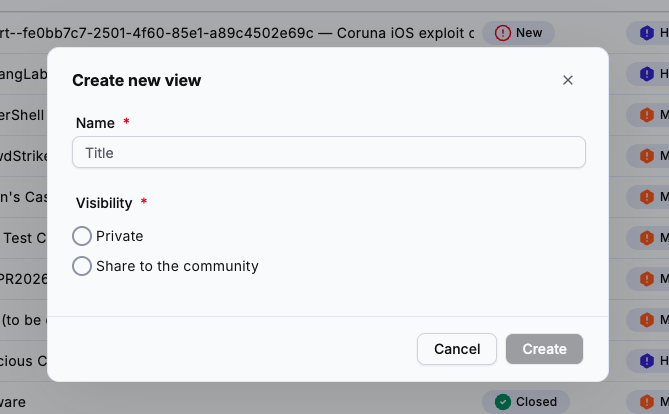
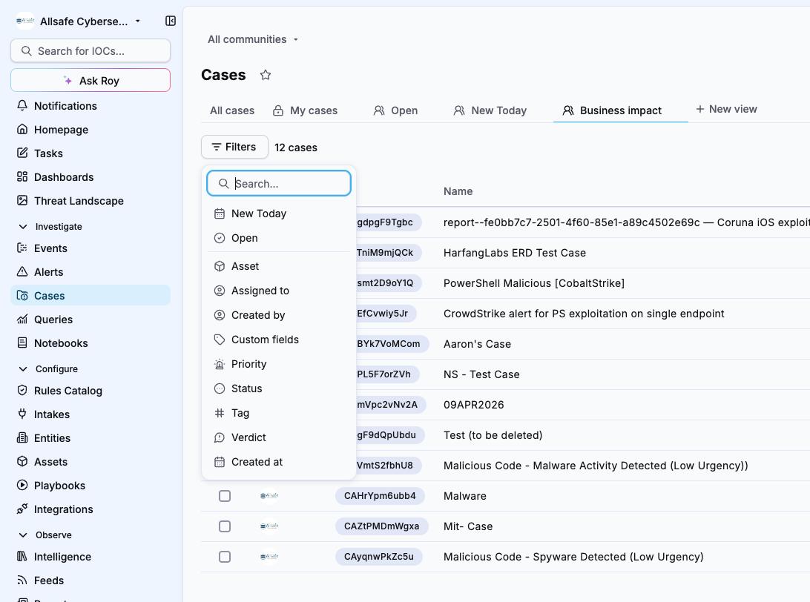
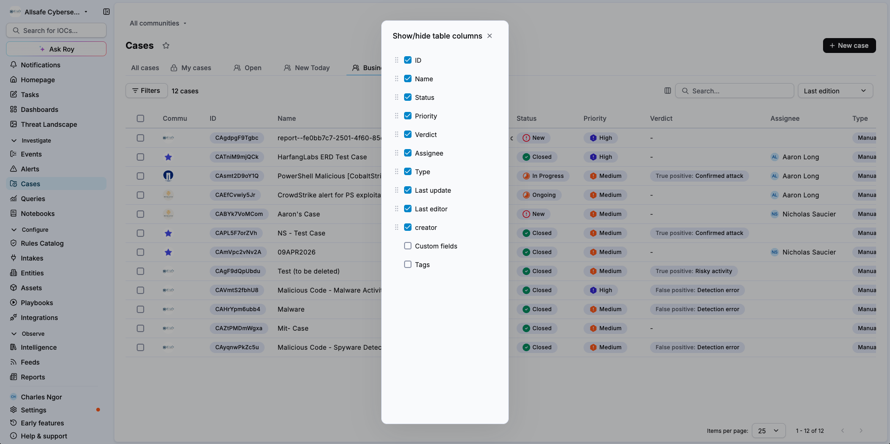
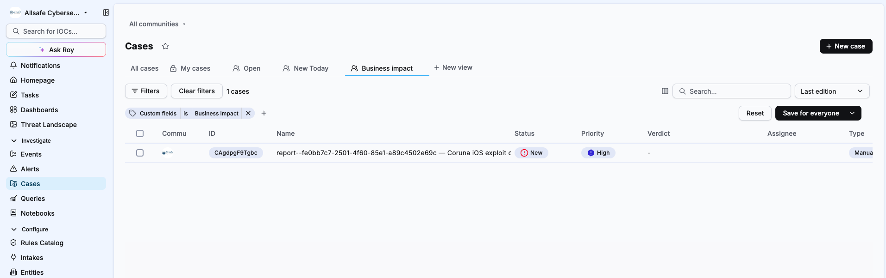
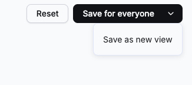
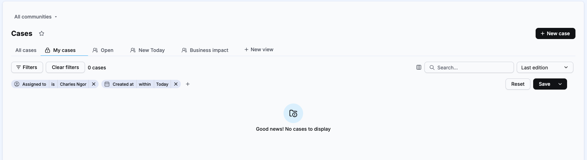
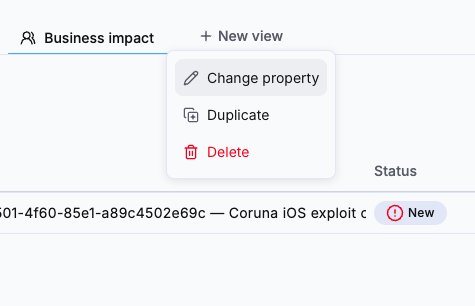
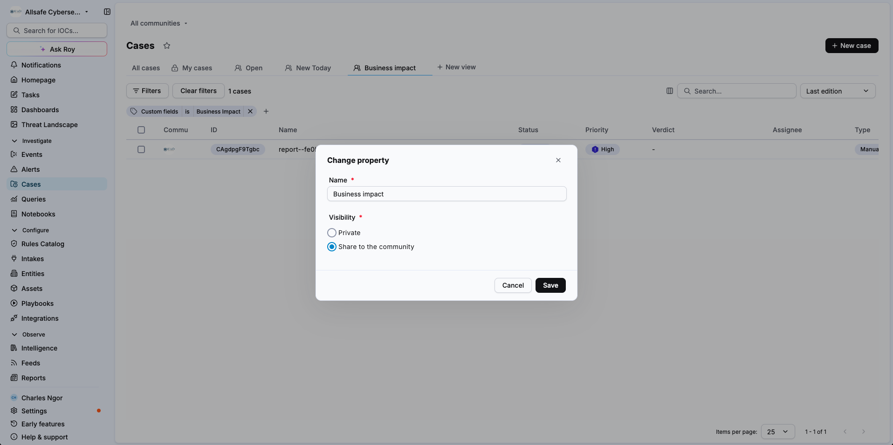
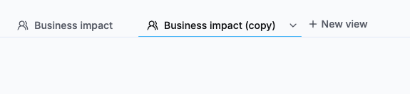
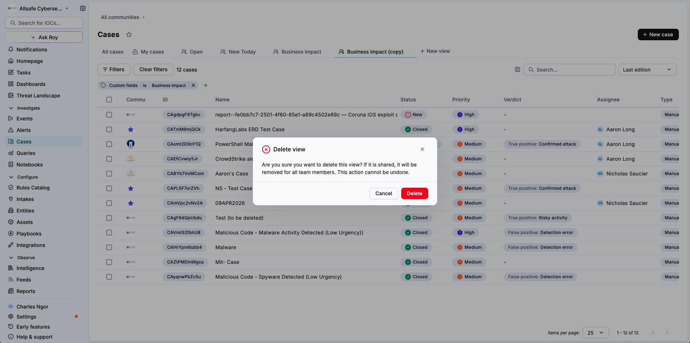

# Manage case custom views

This article explains how to create a custom view on the cases listing page, configure its filters, columns, sort order and search text, and save it. It also covers how to edit, rename, duplicate, delete and reorder your views.


**Early Access**

This feature is currently in Early Access and is only available for Beta testers. Sekoia.io plans to roll out this functionality to all environments soon.


## Prerequisites

* The **Manage case custom views** permission to create, edit and delete views.
* The **View case custom views** permission to list and open views.

For the role setup, see [Roles and permissions](../../../getting_started/roles_and_permissions.md).

## Create a view

1. Navigate to **Cases**.
2. Click **+ New view**.
3. In the **Create new view** window, enter a **Name**.
4. Under **Visibility**, select **Private** to keep the view for yourself, or **Share to the community** to make it available to every user of the community.
5. Click **Create**.

The new view appears in the views bar and opens on all cases. You can now configure it.

## Configure a view

A view stores filters, columns, sort order and search text. Configure any of them, then save the view.

### Add filters

1. Click **Filters**.
2. Select a filter, for example **Custom fields**.
3. Select the value, for example *Business Impact*.

The filter appears as a chip above the list. To add another filter, click `+` next to the existing chips. To remove one, click its `x`.

### Choose the columns

1. Click the columns icon next to the search bar.
2. In **Show/hide table columns**, select the columns you want to display and clear the others.
3. To change the column order, drag a column by its handle.
4. Close the window.

### Change the sort order

1. Click the sort menu, set to **Last edition** by default.
2. Select **Last edition**, **Creation date** or **By highest priority**.

### Search the cases

1. Click the **Search** bar.
2. Enter the text to match.

The list narrows to the matching cases. As with a filter change, **Reset** and the save button appear so you can update the view, see [Save a view](#save-a-view).

## Save a view

As soon as the view differs from its saved state, **Reset** and a save button appear above the list. To discard your changes instead, see [Discard changes to a view](#discard-changes-to-a-view).


**Saving a shared view affects all users**

Saving a shared view updates it for every user of the community. All users with access to the view immediately see the new filters, and this action cannot be undone.


To save a private view, click **Save**.

To save a shared view:

1. Click **Save for everyone**.
2. In the **Save for everyone** window, click **Confirm**.

### Save as a new view

To keep the original view unchanged and save your changes as a separate view, use the arrow next to **Save** or **Save for everyone**.

1. Click the arrow next to **Save** or **Save for everyone**.
2. Click **Save as new view**.
3. In the **Create new view** window, enter a **Name**.
4. Under **Visibility**, select **Private** or **Share to the community**.
5. Click **Create**.

The new view appears in the views bar with your current filters, columns, sort order and search text.

## Edit a view

1. In the views bar, select the view you want to edit.
2. Change the filters, the columns, the sort order or the search text.
3. Save the view as described in [Save a view](#save-a-view).

## Discard changes to a view

When you modify a saved view, your changes apply to the list right away but the view keeps its saved settings until you save it. To cancel your modifications and return to the saved filters, columns, sort order and search text, click **Reset**.

## Change the properties of a view

The name and visibility of a view are its properties.

1. In the views bar, hover the view.
2. Click the arrow next to its name.
3. Click **Change property**.
4. Update the **Name**, the **Visibility**, or both.
5. Click **Save**.

## Duplicate a view

Duplicating a view is useful to start from an existing shared queue and adapt it, for example as a private view.

1. In the views bar, hover the view.
2. Click the arrow next to its name.
3. Click **Duplicate**.

The copy appears in the views bar with the same filters, columns, sort order, search text and visibility, and the suffix *(copy)* added to its name, for example **Business impact (copy)**. To rename it or change its visibility, see [Change the properties of a view](#change-the-properties-of-a-view).

## Delete a view


**Irreversible action**

Deleting a view cannot be undone. If the view is shared, it is removed for every user of the community.


1. In the views bar, hover the view.
2. Click the arrow next to its name.
3. Click **Delete**.
4. In the **Delete view** window, click **Delete**.

## Reorder views

1. In the views bar, drag the view you want to move.
2. Drop it at the position you want.

## Related articles

* [Case custom views](case_custom_views.md): What custom views are, visibility, limits and permissions.
* [Manage cases](manage_cases.md): How to filter, sort and perform bulk actions on cases from the listing page.
* [Custom fields](custom_fields.md): How to extend alerts and cases with structured, typed metadata fields.
* [Roles and permissions](../../../getting_started/roles_and_permissions.md): How built-in and custom roles grant access to platform features.
