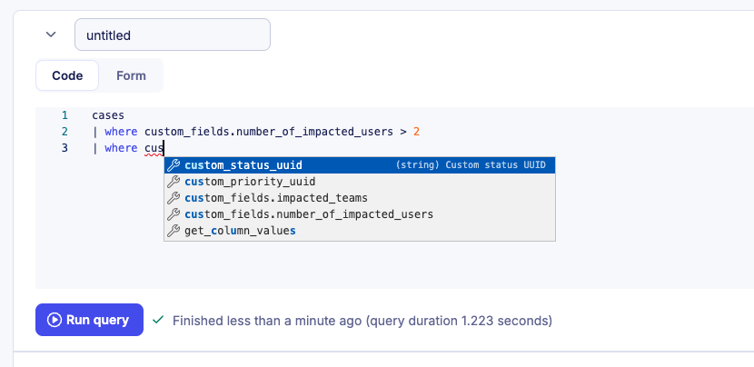
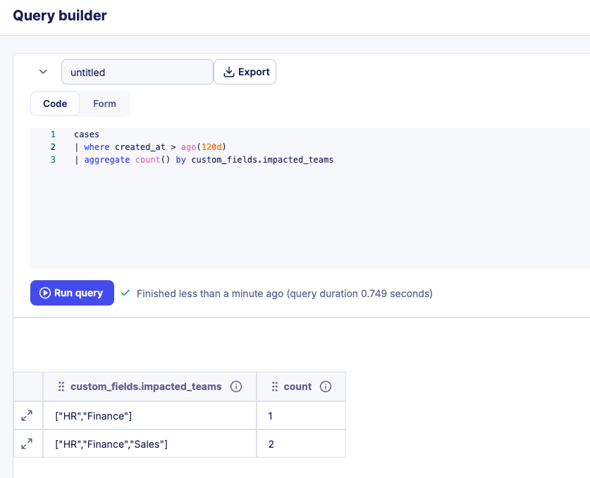

# Query custom fields

Custom fields are queryable through the Sekoia Operating Language (SOL), enabling you to filter alerts and cases, build aggregations, and create dashboard widgets based on structured metadata values. This reference describes the column naming convention and provides ready-to-use query examples.

## Column naming convention

Custom fields are accessible in SOL through the `custom_fields` prefix, on both the `alerts` and the `cases` datasources. The field name is automatically converted to snake_case to form the column name:

| Field name | SOL column |
|---|---|
| Number of impacted users | `custom_fields.number_of_impacted_users` |
| Impacted teams | `custom_fields.impacted_teams` |
| Attack vector | `custom_fields.attack_vector` |


**Autocomplete support**

The SOL query editor provides autocomplete for custom field columns. Enter `custom_fields.` to see all available fields for your workspace.




## Query examples

Each example is shown against both datasources. The syntax is identical, only the datasource on the first line changes.

### Filter by a numeric field

To retrieve alerts or cases where a numeric custom field exceeds a given value:




```
alerts
| where created_at > ago(90d) and custom_fields.number_of_impacted_users != null
| where custom_fields.number_of_impacted_users > 2
```



```
cases
| where created_at > ago(90d) and custom_fields.number_of_impacted_users != null
| where custom_fields.number_of_impacted_users > 2
```



### Filter by a multi select field

To retrieve alerts or cases where a multi select field contains specific values:




```
alerts
| where created_at > ago(90d)
| where custom_fields.impacted_teams in ["HR", "Finance"]
```



```
cases
| where created_at > ago(90d)
| where custom_fields.impacted_teams in ["HR", "Finance"]
```



### Aggregate by a custom field

To count alerts or cases grouped by a custom field value:




```
alerts
| where created_at > ago(90d)
| aggregate count() by custom_fields.impacted_teams
```



```
cases
| where created_at > ago(90d)
| aggregate count() by custom_fields.impacted_teams
```





## Use query results in dashboards

You can use any custom field query as the data source for a dashboard widget. For instructions on creating and configuring widgets, see the [dashboards documentation](../report/add_widgets_dashboards.md).

## Related articles

* [Custom fields](custom_fields.md): Overview of custom field types, shared definitions, multi-tenancy behavior, and workspace limits.
* [Manage custom field definitions](manage_custom_field_definitions.md): How to create, edit, and delete custom field definitions.
* [Use custom fields](use_custom_fields.md): How to add and edit custom field values on individual alerts and cases.
* [Reference: Datasources](sol_ref_datasources.md): Every property exposed by the `alerts` and `cases` datasources.
* [Manage cases](manage_cases.md): How to filter cases by custom field values from the listing page.
* [Dashboards](../report/add_widgets_dashboards.md): How to build widgets and visualizations from SOL queries including custom field data.
