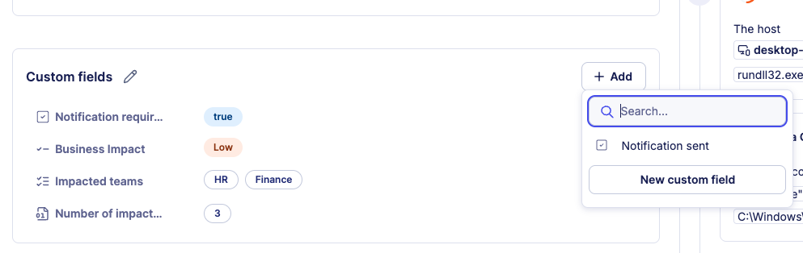

# Use custom fields

Custom fields let you attach structured metadata to individual alerts and cases. This article explains how to add custom field values to an alert or a case, and how to update them during an investigation.

## Prerequisites

Custom field definitions must exist in your workspace before you can use them. If no fields are available, ask your administrator to create definitions in **Settings > Custom fields**.


**Definition creation**

[Read more about custom field definition creation in our dedicated article.](https://docs.sekoia.com/xdr/features/investigate/manage_custom_field_definitions/)


## Add a custom field

The screenshot below shows the **Custom fields** section on a case. The section looks and behaves identically on the alert details page.


**Auto-added fields**

Fields configured with **Auto-add to new alerts** or **Auto-add to new cases** appear automatically on every new alert or case. You only need to fill in their values.


To add a custom field value:

1. Open the alert or case details page.
2. Locate the **Custom fields** section.
3. Click **+ Add**.
4. Select the field from the dropdown.
5. Enter or select the appropriate value.
6. Click **Save**.

## Edit a custom field value

To update an existing custom field value:

1. Open the alert or case details page.
2. In the **Custom fields** section, click the field you want to edit.
3. Modify the value.
4. Click **Save**.

All changes to custom field values on a case are recorded in the case history, providing a complete audit trail of modifications.

## Related articles

* [Custom fields](custom_fields.md): Overview of custom field types, shared definitions, multi-tenancy behavior, and workspace limits.
* [Manage custom field definitions](manage_custom_field_definitions.md): How to create, edit, and delete custom field definitions in workspace settings.
* [Query custom fields](query_custom_fields.md): SOL syntax and examples for filtering and aggregating alerts and cases by custom field values.
* [Alerts](alerts.md): How to filter the alerts listing by custom field values and read the alert details page.
* [Case details](case_details.md): Reference for every tab and field available on the case details page.
* [Manage cases](manage_cases.md): How to filter cases by custom field values from the cases listing page.
