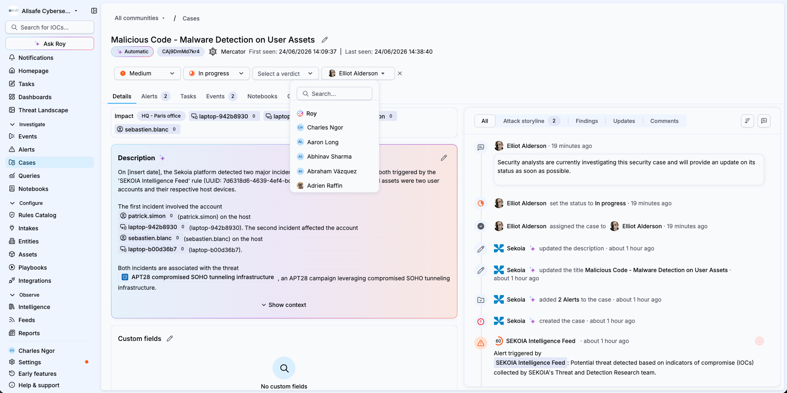

# Investigate a case with Elevate

Elevate investigates cases the same way it investigates alerts. This article explains how to trigger a case investigation by assigning the case to Roy, and what the case displays once the analysis is complete.

## Prerequisites

- Elevate is activated on your workspace or community. See [Activate Sekoia Elevate on a workspace](elevate_activate.md).

## Assign the case to Roy

Roy is the Elevate investigation agent. Assigning a case to Roy triggers an immediate investigation.

1. Navigate to **Cases**.
2. Select the case you want to analyze.
3. Select the **Assignee** field in the case header.
4. Select **Roy**.

## Result

The agent begins investigating the case. Once complete, the case displays the **verdict** (with its confidence score and explanation), the **findings**, and the **reasoning questions**, the same outputs as an alert investigation. To learn how to read them, see [Investigate an alert with Elevate](elevate_investigate_alert.md) and [The Elevate investigation method](elevate_investigation_method.md).


**Case-level investigation**

Elevate investigates the case as a whole and produces a single case-level verdict, findings and reasoning questions. It does not generate separate verdicts for the individual alerts contained in the case.



**Run consumption**

A case investigation consumes one run from your monthly run pack, the same as an alert investigation.


## Related articles

- [Investigate an alert with Elevate](elevate_investigate_alert.md): How to read the verdict, findings and reasoning questions of an Elevate investigation.
- [The Elevate investigation method](elevate_investigation_method.md): How runbooks, reasoning questions, findings and verdicts work together.
- [Audit an Elevate investigation with Traces](elevate_traces.md): How to review the full timeline of actions the agent performed.
- [Trigger a manual Elevate analysis](elevate_manual_analysis.md): How to investigate an alert that was not analyzed automatically.
- [Manage your Elevate runs](elevate_quota.md): How to monitor and optimize your monthly run pack.
