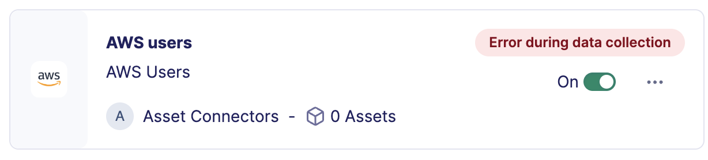
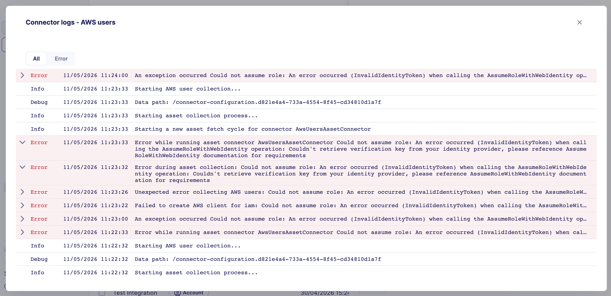

# Troubleshoot asset connectors

This article explains how to identify and resolve issues with asset connectors using error indicators and connector logs.

## Before you begin

To access the asset connector list, navigate to **Configure > Assets > Asset connectors**.

## Step 1: Identify a defective connector

Review the connector list. A connector with an issue displays an error message in the upper right corner of its tile.


**Zero assets warning**

If a connector tile shows 0 assets, this may indicate a synchronization issue even if no error message is visible. Inspect the logs to confirm.


## Step 2: Open the connector logs

1. On the defective connector tile, select **...**.
2. Select **View logs**.

The full log list opens.

## Step 3: Diagnose the issue

Review the log entries to identify the root cause. Common issues include:

| Symptom | Likely cause |
|---|---|
| Authentication error | Invalid or expired credentials |
| Permission denied | Insufficient rights on the external system |
| No assets retrieved | The account cannot see any asset on the external system (wrong tenant or missing permissions) |
| Timeout | Network connectivity issue or external system unavailable |

## Step 4: Edit the connector configuration

If the issue is caused by a misconfiguration or expired credentials:

1. Close the logs panel.
2. On the connector tile, select **...**.
3. Select **Edit**.
4. Update the relevant fields such as the API key or client ID.
5. Select **Test connector** to validate the updated credentials.
6. When the test is conclusive, select **Edit asset connector**.

The connector resumes synchronization with the updated configuration.


**What the test checks**

The test validates credentials only. It does not retrieve assets. Verify asset retrieval from the **Assets** page after saving.


## Related links

- [Create an asset connector](reveal_asset_connectors_create.md) — How to configure a new asset connector from the integration catalog.
- [Reveal feature enablement matrix](reveal_feature_enablement.md) — Which data sources are required for each Reveal capability.
- [Security controls](reveal_security_controls.md) — How to verify connector coverage and identify visibility gaps from the asset context panel.
- [Troubleshoot Reveal](reveal_troubleshoot.md) — General Reveal troubleshooting for missing data across capabilities.
