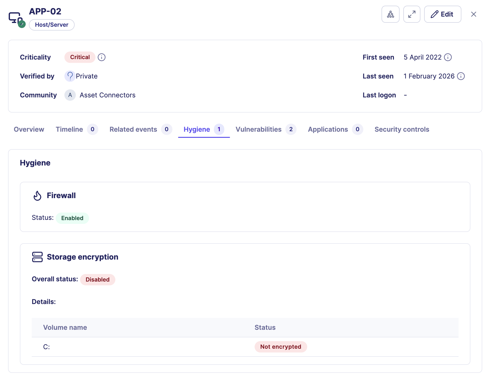

# Endpoint Hygiene

_**[Reveal module](reveal_index.md)** — This feature requires the Reveal add-on module._ 

Endpoint Hygiene shows the security posture and configuration health of host assets in Sekoia. It surfaces whether key protections such as the firewall and disk encryption are active, giving analysts immediate visibility into whether an endpoint is properly protected at the time of investigation.

Hygiene data is available in the asset context panel under the **Hygiene** tab and summarized in the **Health check** card **Misconfigurations** tile on the **Overview** tab.

## How Endpoint Hygiene works

Reveal collects hygiene signals from the Sekoia Endpoint Agent or from connected asset connectors that support endpoint posture data. The signals reflect the state of the endpoint at the time of the last successful synchronization.


**Data source**

Hygiene data requires the Sekoia Endpoint Agent or a connector that provides endpoint posture. Without one of these sources, the Hygiene tab does not display data. See [Getting started with Reveal](reveal_getting_started.md).


## Hygiene signals

The following signals are currently available for host assets.

| Signal | Description |
|---|---|
| Firewall | Indicates whether the host firewall is enabled or disabled |
| Disk encryption | Indicates the global encryption state and per-volume details |

Additional signals may be available depending on the capabilities of the connected source.

## How to use Endpoint Hygiene during an investigation

Hygiene signals help analysts answer three types of questions at different stages of an investigation.

**During triage:** confirm whether the affected asset has basic protections in place. An asset with a disabled firewall or unencrypted disk represents a higher risk and may warrant faster escalation or containment.

**During root cause analysis:** identify whether a missing or disabled control contributed to the compromise. A disabled firewall on a host involved in a lateral movement alert may explain how traffic was not blocked.

**After remediation:** validate that controls were re-enabled before returning the asset to production.

Hygiene context during a ransomware investigation

A ransomware alert targets *FIN-SRV02*. The Hygiene tab shows that disk encryption is disabled on the primary data volume. This confirms that data on that volume is at risk of exposure if the host is compromised, and accelerates the decision to isolate and remediate the asset before the investigation is closed.

## Health check card summary

The **Health check** card on the **Overview** tab shows the total count of hygiene misconfigurations alongside open vulnerabilities and active security controls. Use it for a quick posture snapshot before opening the full Hygiene tab.

For a full reference of the Health check card and all Reveal-specific overview sections, see [Asset context panel: Reveal capabilities](reveal_asset_context_panel.md).

## Related links

- [Asset context panel: Reveal capabilities](reveal_asset_context_panel.md): Full reference for Reveal-specific sections including the Hygiene tab and Health check card.
- [Getting started with Reveal](reveal_getting_started.md): How to deploy the Sekoia Endpoint Agent and configure connectors for hygiene data.
- [Create an asset connector](reveal_asset_connectors_create.md): How to connect an external system that provides endpoint posture data.
- [Vulnerability enrichment](reveal_vulnerabilities.md): How CVE exposure data complements hygiene signals during posture assessment.
- [Reveal feature enablement matrix](reveal_feature_enablement.md): Data source requirements for Endpoint Hygiene and other Reveal capabilities.
